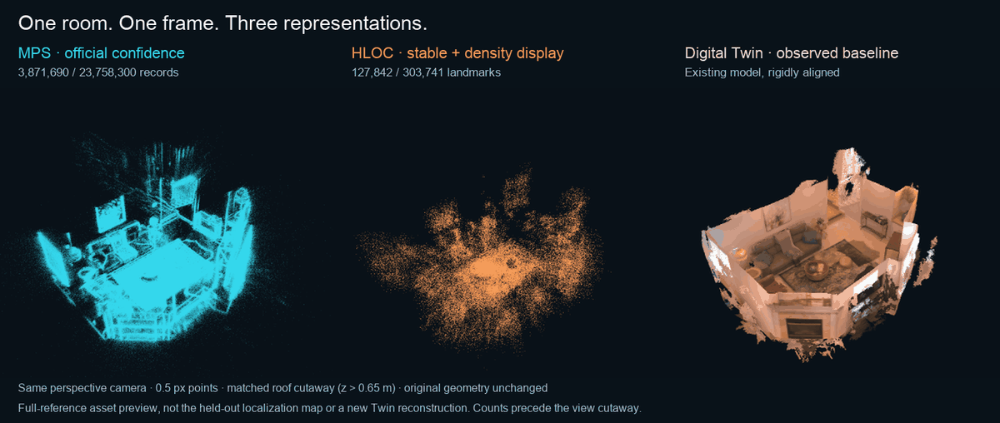
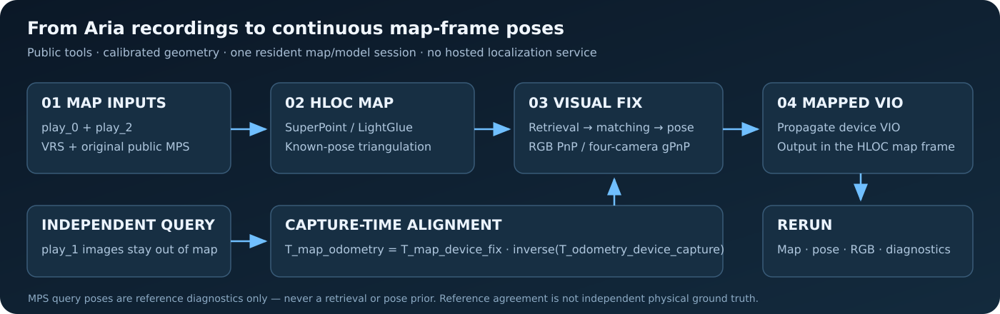
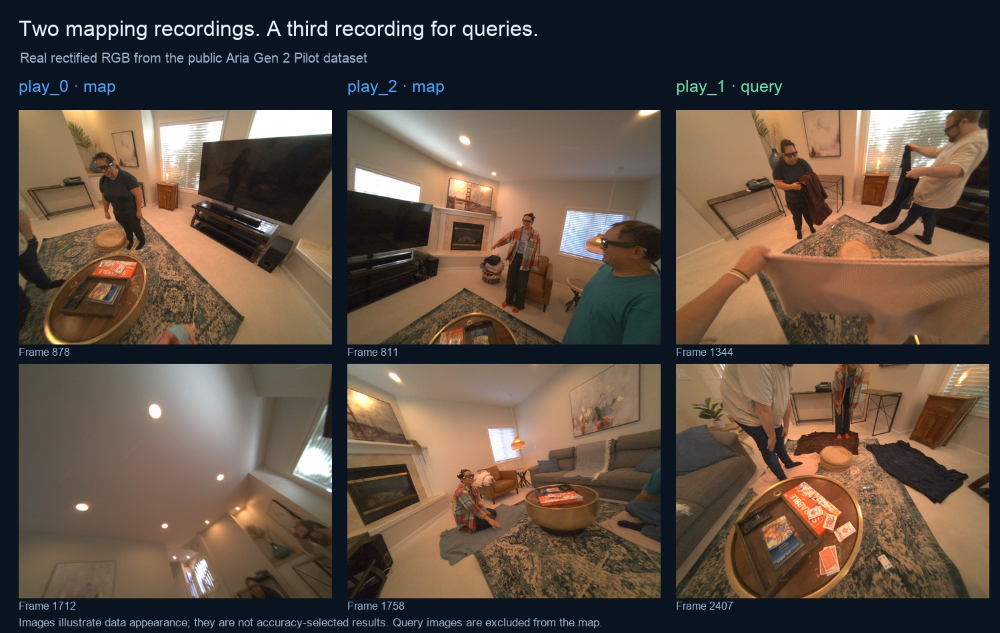
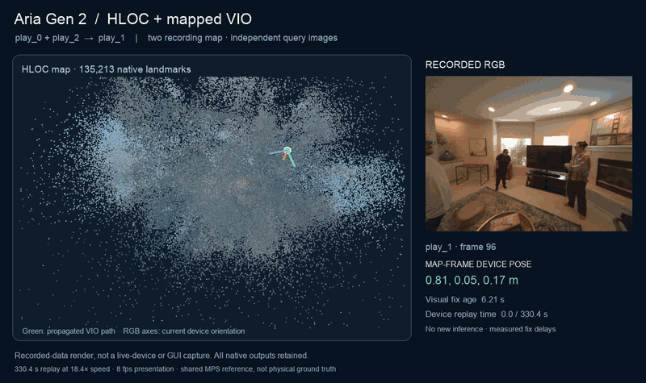

# Aria Gen 2 HLOC

**Two recordings to map. A third to localize.**

Build a metric visual map from Aria VRS/MPS, localize RGB or four-camera SLAM
queries, and carry visual corrections forward with recorded or live VIO.

<p>
  <kbd>Python 3.12</kbd>
  <kbd>pycolmap 4.2.1</kbd>
  <kbd>Offline Pilot replay</kbd>
  <kbd>RGB + four-camera rig</kbd>
  <kbd>Rerun</kbd>
</p>

[Quickstart](#quickstart) · [Results](#results-on-pilot) ·
[Runtime & frames](#runtime-and-frame-contracts) ·
[Notebook](hloc_example.ipynb) · [Benchmark](benchmarks/pilot_multitrajectory.json)



*Same-frame asset preview: official-confidence MPS, stable HLOC with a
visualization-only neighbourhood filter, and the existing observed Twin aligned
to that frame. Small points and a matched roof cutaway reveal the room interior;
original geometry is unchanged. This full-reference preview is separate from
this example's held-out query evaluation and is not a new Twin reconstruction.*

[Still image](assets/pilot-room-comparison.jpg) ·
[Display filters and source provenance](assets/pilot-room-comparison-provenance.json)

## What it does



**Map:** `play_0` + `play_2` → **Query and replay:** `play_1`.
The query recording never enters mapping features, triangulation or retrieval.
Its MPS supplies calibration and same-graph reference comparisons, not a pose prior.



*Three recordings, separate clocks and calibration, one shared original public
MPS frame. No new MPS request or glasses are needed for this recorded workflow.*

- **Build** with known MPS poses and public HLOC features/matches (`build_map.py`).
- **Localize** with NetVLAD, SuperPoint/LightGlue and COLMAP PnP or rig gPnP (`query_map.py`).
- **Align and visualize** VIO with capture-time visual fixes (`replay_demo.py`, `live_demo.py`).

## Results on Pilot

The RGB map contains **1,360 keyframes** (666 + 694), **135,213 landmarks** and
**14,870 cross-recording tracks**. All **100 RGB + 50 rig queries** completed;
source fingerprints, native tracks and unchanged map contents were checked.


| Queries | Gate passes | Accepted / MPS-covered | ≤10 cm & ≤5° | ≤25 cm & ≤5° | Median query |
|---|---:|---:|---:|---:|---:|
| RGB | 98 / 100 | 97 / 99 | 89 / 99 | 93 / 99 | 6.1044 s |
| Four SLAM | 48 / 50 | 47 / 48 | 47 / 48 | 47 / 48 | 12.8530 s |

Threshold denominators include **all MPS-covered queries, including failures**.
Gate acceptance is not accuracy: accepted-reference maximum disagreements were
**0.418 m / 13.23° RGB** and **0.075 m / 2.29° rig**. No accepted reference-covered
pose exceeded 1 m or 170° in this run; that is not a false-positive guarantee.

These are fixed, previously exposed anchors, not a new blind evaluation. Shared
MPS may jointly optimize the query recording: its poses are **not independent
physical ground truth**. No cross-day or unseen-location guarantee is made.

Query timing is observational **Linux CPU, eight threads, concurrent jobs**:
p90 was **7.02 s RGB / 13.89 s rig**. Preparation (**8.66 s**) and recording/
trajectory opening (**18.80 s**) are separate. First RGB query was **8.37 s**;
subsequent RGB median/p90 was **6.06 / 6.96 s**. One prepared backend served RGB
then rig; separate CLI invocations each initialize. This is not a controlled
speed-gain, cold-disk, GPU or real-time benchmark. Peak RSS was about **4.09 GiB**.

[Full protocol, timestamps, failures, quantiles and evidence hashes](benchmarks/pilot_multitrajectory.json).
RGB indices are exactly `0, 34, ..., 3366`. Measured rig queries used 50 uniformly
spaced endpoint-inclusive indices (208/209 gaps; last 10200); the stride-208
quickstart approximates that coverage, not those exact anchors or scores.

### Recorded replay



*The 330.4-second mapped interval is shown in 18 seconds (18.4× playback).
Visual fixes retain measured query delays; presentation speed is not inference
speed or a live-device measurement.*

[Higher-resolution video](assets/pilot-relocalization.webm) ·
[Media provenance](assets/README.md)

Native replay, row-wise JSONL/PoseAlignment parity and RRD verification passed:
**271,964 VIO inputs → 265,344 mapped poses**, with **6,620 initially unaligned/
lost samples**. All 100 RGB cache entries remain; scheduling yields **56 arrivals
within VIO coverage and 55 accepted fixes**, not 100 played fixes. The other
entries are 42 superseded, one outside coverage and one late arrival. Failed
anchor 37 was scheduled; failed anchor 75 was superseded, not manually filtered.

First mapped output is **8.242 s after the first recorded VIO sample**, not cold
startup; first-fix capture-to-arrival is separately **6.205 s**. The **803.03 Hz**
mapped-pose rate is in recorded device time, not visual-fix frequency or live
throughput. GUI poses are capped at **30 Hz**. RRD shows all sparse-map positions
with uniform colors and a 640-pixel/JPEG-90 RGB preview, not original point RGB
or a textured reconstruction; separate original-color point exports are not bundled.

## Quickstart

Use **Python 3.12**, the pinned environment and local disk space for all three
recordings plus generated maps. Upstream models download weights on first
inference. This workflow does not accept dataset terms or request MPS for you.

<details>
<summary><strong>1. Install the pinned environment</strong></summary>

Use these clone commands when the public repository is available:

```bash
git clone --recurse-submodules https://github.com/facebookresearch/projectaria_hloc_example.git
cd projectaria_hloc_example
conda env create -f environment.yml
conda activate aria_hloc
python -m pip install --no-deps -e ./Hierarchical-Localization
git -C Hierarchical-Localization apply ../patches/hloc-workers.patch
```

HLOC is pinned to `c13273bd0ecc2917a35910fd843712a1c6243193`, LightGlue to
`edb2b838efb2ecfe3f88097c5fad9887d95aedad`, and pycolmap to `4.2.1`.
Runtime checks the HLOC commit and COLMAP version. Recursive cloning initializes
nested submodules; `--no-deps` preserves environment pins.

Apply the worker patch **once** to the exact checkout. Algorithm defaults stay
fixed; the wrapper uses zero DataLoader workers on macOS and two on Linux.
Zero avoids a reproduced macOS shutdown hang; the CPU-container measurements
also used zero because shared memory could not support two.

**macOS OpenMP troubleshooting.** If separate torch/pycolmap copies cause
`OMP: Error #15` or `#179`, unify them only inside the activated example environment:

```python
from pathlib import Path
import sysconfig

site = Path(sysconfig.get_paths()["purelib"])
omp = site / "pycolmap/.dylibs/libomp.dylib"
if not omp.is_symlink():
    omp.rename(omp.with_name("libomp.dylib.original"))
    omp.symlink_to("../../torch/lib/libomp.dylib")
```

Do not use `KMP_DUPLICATE_LIB_OK` or force process exit to hide failures.

</details>

<details>
<summary><strong>2. Download and check all three Pilot recordings</strong></summary>

Open the [official Pilot Explorer](https://explorer.projectaria.com/gen2pilot),
follow its access/consent flow and obtain the URL-list JSON for `play_0`, `play_2`
and `play_1`. Use the **original public VRS/MPS outputs**, not a private joint-MPS
rerun. Download only VRS, trajectory and calibration; do not guess asset URLs
or commit generated CDN lists.

```bash
aria_dataset_downloader -c /path/to/play_0_download_urls.json \
  -o data/pilot -l play_0 -d 0 1 2
aria_dataset_downloader -c /path/to/play_2_download_urls.json \
  -o data/pilot -l play_2 -d 0 1 2
aria_dataset_downloader -c /path/to/play_1_download_urls.json \
  -o data/pilot -l play_1 -d 0 1 2
python check_inputs.py --vrs data/pilot/play_0/video.vrs --mps data/pilot/play_0/mps
python check_inputs.py --vrs data/pilot/play_2/video.vrs --mps data/pilot/play_2/mps
python check_inputs.py --vrs data/pilot/play_1/video.vrs --mps data/pilot/play_1/mps
```

Downloader IDs `0`, `1`, `2` are `main_vrs`, `mps_slam_trajectories` and
`mps_slam_calibration`. No point cloud, depth, ASR or full Pilot loader is required.
The example does not rehost Pilot; its source access/distribution terms apply.

```text
data/pilot/
  play_0/video.vrs
  play_0/mps/slam/{closed_loop_trajectory.csv,online_calibration.jsonl}
  play_2/video.vrs
  play_2/mps/slam/{closed_loop_trajectory.csv,online_calibration.jsonl}
  play_1/video.vrs
  play_1/mps/slam/{closed_loop_trajectory.csv,online_calibration.jsonl}
```

Check every listed file before building. `check_inputs.py` decodes/rectifies all
five camera streams and checks MPS coverage without HLOC inference; its default
is `play_0`, so check the others explicitly. All three trajectories must share
one **nonempty `graph_uid`**, not merely a scene name. The notebook checks this
and the three VRS fingerprints before building.

</details>

<details>
<summary><strong>3. Build the RGB map from play_0 + play_2</strong></summary>

```bash
export OMP_NUM_THREADS=8 OPENBLAS_NUM_THREADS=8
python build_map.py \
  --vrs data/pilot/play_0/video.vrs data/pilot/play_2/video.vrs \
  --mps data/pilot/play_0/mps data/pilot/play_2/mps \
  --camera-set rgb --output-dir maps/pilot_play02_rgb
```

VRS/MPS lists are parallel: `s000` is `play_0`, `s001` is `play_2`, each with its
own clock and calibration. The two full-VRS SHA-256 values must be distinct;
neither may equal `play_1`. Disconnected/empty graphs are rejected before inference.

Pass `rgb` explicitly: the CLI default is `slam`; `slam`/`all` are supported
builder variants, not this measured map. Leave `--max-keyframes 0` (uncapped).
Use a new output directory. The builder writes rectified images, known-pose
`reference/`, COLMAP `sfm/`, features/retrieval/matches HDF5, pairs, statistics
and `map.json`; failed builds do not receive a completed manifest.

If this exact map already exists, **skip building** and use the notebook's
fingerprint check. `source_vrs_sha256` must equal exactly the two hashes in
`play_0`, `play_2` order, not an unordered set. Do not automatically rebuild
or substitute a map with different inputs.

</details>

<details>
<summary><strong>4. Query the separate play_1 recording</strong></summary>

```bash
python query_map.py --map maps/pilot_play02_rgb --vrs data/pilot/play_1/video.vrs \
  --mps data/pilot/play_1/mps --mode rgb --num-queries 100 --stride 34 \
  --output queries/pilot_play1_multi_rgb.json
```

Never pass `play_1` to the builder or append its features to retrieval. Query MPS
supplies its calibration and optional reference comparisons, not pose/retrieval
priors. Verify `source_identity_check: "sha256"`,
`query_in_mapping_recordings: false`, and that `query_vrs_sha256` is absent from
the map's two ordered source hashes.

Optional four-camera gPnP queries against the **same RGB-built map**:

```bash
python query_map.py --map maps/pilot_play02_rgb --vrs data/pilot/play_1/video.vrs \
  --mps data/pilot/play_1/mps --mode slam --num-queries 50 --stride 208 \
  --output queries/pilot_play1_multi_slam.json
```

Stride samples every Nth anchor without repeating frames. RGB stride 34 matches
the measured indices; rig stride 208 only approximates the measured endpoint-
uniform schedule. Report your actual counts/results, not assumed reference scores.
Query caches are not overwritten; choose a new path for a new run.

</details>

<details>
<summary><strong>5. Replay play_1 VIO and open Rerun</strong></summary>

```bash
python replay_demo.py --map maps/pilot_play02_rgb --vrs data/pilot/play_1/video.vrs \
  --mps data/pilot/play_1/mps --fixes queries/pilot_play1_multi_rgb.json \
  --output-dir outputs/pilot_play1_multi_replay
rerun --bind 127.0.0.1 outputs/pilot_play1_multi_replay/view.rrd
```

Use `play_1` VIO and **its** RGB query cache. Outputs are `poses.jsonl`, `view.rrd`
and `replay_stats.json`; cache checks cover map frame and testing VRS fingerprint.
Orbit the sparse map, scrub recorded time and inspect RGB, pose and fix age.
Replay retains measured cached delays; it does not rerun models, interpolate
MPS reference poses into outputs or measure hardware throughput.

[The notebook](hloc_example.ipynb) follows these same inputs. Its source cells
are intentionally unexecuted with no fabricated outputs.

</details>

## Runtime and frame contracts

<details>
<summary><strong>Resident inference, map identity and timing</strong></summary>

The batch and live worker prepare map/models once and reuse them across queries
and VIO session resets. A reset clears alignment and rejects obsolete fixes,
not the resident runtime. Changing maps requires an explicit transition: do not
replace files while a localizer uses them. Resources close on normal exit/errors.

Decoded query images, features and matches stay in memory; no query PNG/HDF5
staging is needed. Reconstruction, normalized NetVLAD descriptors and the
feature-to-landmark index are immutable/reused. Reference local features use a
**256 MiB byte-bounded CPU LRU**, not an unbounded GPU cache or total-RAM limit;
weights, global descriptors, reconstruction and query tensors are outside that bound.
Reuse does not retune retrieval, geometry, RANSAC or acceptance thresholds,
filter weak landmarks, introduce VIO retrieval priors or eliminate false poses.

Query JSON separates `initialization_durations_sec`, `stage_durations_sec`,
`query_duration_sec` and `query_end_to_end_duration_sec`. End-to-end recorded
query time includes decode/rectification and keyframe checks, but excludes
initialization, VRS hashing, reference-error evaluation and live queue/bracket
waiting. First-query and subsequent warm durations remain separate measurements.

Full VRS SHA-256 identifies recordings even after copying/renaming. A non-keyframe
from a mapping recording is still a same-recording test. Legacy path-only maps
load with a warning and unknown membership (`null`); they cannot prove independence.
Raw recordings, generated maps, weights and local outputs are not bundled/hosted.
Full-reference maps containing queries cannot establish independent validation.

</details>

<details>
<summary><strong>Coordinate conventions and pose gates</strong></summary>

`T_A_B` maps B into A. Known-pose mapping uses
`T_world_camera = T_world_device @ T_device_camera`; outputs are metric poses
in the map's MPS frame, **not GPS or device Location writes**. PAT principal
points and query keypoints each receive one half-pixel conversion at the COLMAP
boundary. The generalized solver takes camera-from-device extrinsics; its
returned device-from-world pose is inverted.

Rig frames span at most **2 ms** in corrected exposure time:
`capture_timestamp_ns - round(time_offset_sec_device_camera * 1e9)`.
Raw time/offset are retained. Pose association is bounded at 2 ms, online
calibration at 1 s; no extra upright rotation or rig VIO motion compensation is
applied. Query calibration comes from the query recording; MPS diagnostics
require the same graph frame.

A pose needs **≥20 distinct inlier landmarks** and both observation/landmark
ratios **≥0.2**. Conflicting duplicate assignments are discarded. These gates
are not a guarantee against incorrect accepted poses or corrupted VIO alignment.

The builder accepts one or more recordings; multiple inputs require MPS paths
in VRS order, or a Multi-SLAM root with `vrs_to_multi_slam.json`. Mixed/empty
graphs are rejected. Never include evaluation queries in mapping. Maps rebuilt
under different MPS poses need matching geometry/metadata; optional Twin/display
assets are separate future work, not inputs to matching, localization or ground truth.

</details>

<details>
<summary><strong>Live map-frame VIO for your own environment</strong></summary>

Pilot replay needs no glasses; its apartment map will not localize an unrelated
room. For physical streaming, first map your environment and pair/configure
USB-NCM with the public SDK:

```bash
python live_demo.py --map maps/MY_ENVIRONMENT_RGB --profile profile9 \
  --device-ip DEVICE_USB_IP --bind-address HOST_USB_NCM_IP \
  --output-dir outputs/live
```

High-frequency VIO is the sole default; `--vio-stream regular` is an explicit
lower-rate alternative, never a merge of independently queued streams. One RGB
query runs with one latest pending frame. Inference/output sinks run off callbacks;
a full pose-output queue is fatal, not silent loss. `--viewer none` records
without a window; Ctrl+C closes outputs.

At corrected capture time, use valid interpolated VIO brackets without extrapolation:

```text
T_map_odometry = T_map_device_visual_fix @ inverse(T_odometry_device_at_capture)
T_map_device(t) = T_map_odometry @ T_odometry_device(t)
```

Regular VIO composes `T_odometry_bodyimu @ T_bodyimu_device`; high-frequency VIO
already supplies device poses. JSONL retains original device time, session,
`T_map_device`, fix time, `fix_age_ns` and status. Bad VIO is not published;
new odometry sessions clear alignment/reject old fixes. Fixes older than 120 s
are stale; three seconds without host arrivals marks lost.

The worker reports rectification/inference duration separately from queue/bracket
waiting. Corrections can jump: this is alignment/propagation, not a VIO estimator
or smoother. Physical USB streaming/native desktop qualification remains
unverified; recorded-data Rerun web inspection is not live-glasses validation.

</details>

## Scope and support

This is a standalone reference example, not a core Aria Research Kit component,
hosted localization service, internal algorithm, agent, dense reconstruction or
other-device port. Raw recordings, generated map binaries and model weights are
not shipped with runtime source. Recorded-data checks are not complete asset/public-release approval or
safety-critical tracking assurance. Maintenance covers the released snapshot,
not continuous upstream upgrades or internal pipeline parity.

```bash
python -m pytest tests
```

Tests mock SDK/PAT/Rerun at call sites and use synthetic geometry, not glasses,
recordings, model downloads or online MPS. Native tests exercise pinned public
COLMAP; unit coverage is distinct from the Pilot evaluation.

Example/setup issues belong here; upstream algorithm issues may go to
[HLOC](https://github.com/cvg/Hierarchical-Localization/issues),
[LightGlue](https://github.com/cvg/LightGlue/issues), or
[Project Aria Tools](https://github.com/facebookresearch/projectaria_tools/issues).
See [CONTRIBUTING.md](CONTRIBUTING.md) and [LICENSE](LICENSE). Meta-authored code
is Apache 2.0; data, dependencies and weights retain their source terms.
