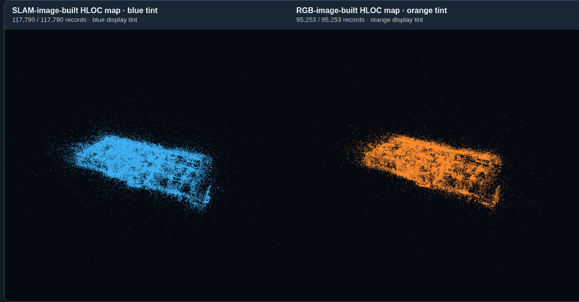
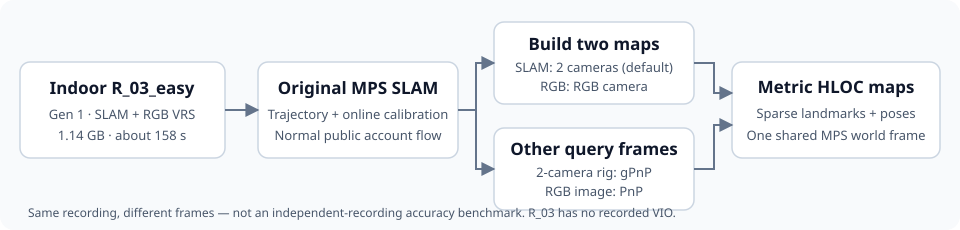
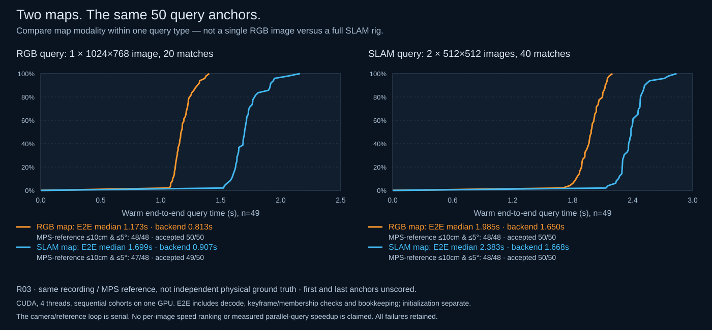
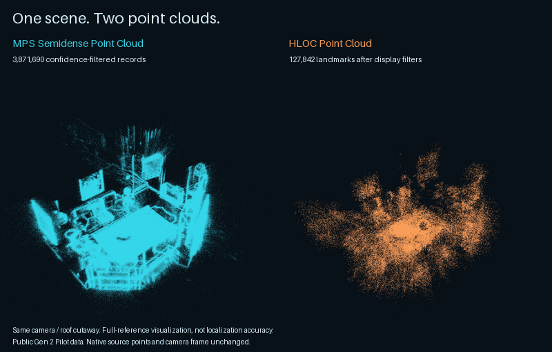
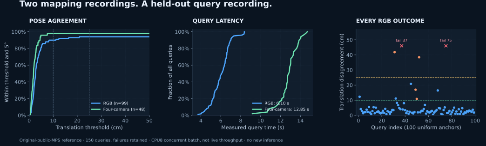
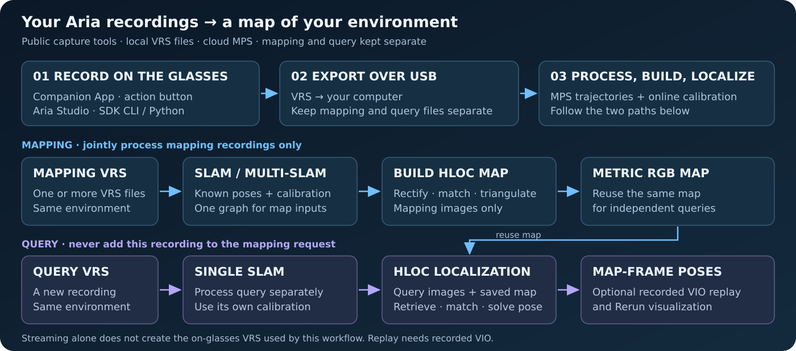

# Aria HLOC — Gen 1 and Gen 2

**Map an indoor space. Localize in its visual map.**

Build metric visual maps from Aria VRS/MPS and localize native SLAM-camera rig
queries (two cameras on Gen 1, four on Gen 2) or RGB queries. Build a SLAM map for
Aria recordings and an RGB map for RGB images, both in the same MPS frame.
Recordings with VIO can also carry visual corrections forward in the optional
replay or live workflow.

<p>
  <kbd>Python 3.12</kbd>
  <kbd>pycolmap 4.2.1</kbd>
  <kbd>Indoor LaMAria example</kbd>
  <kbd>SLAM + RGB maps</kbd>
  <kbd>Rerun</kbd>
</p>

[Indoor quickstart](#quickstart) · [Results](#results-on-lamaria) ·
[Pilot + VIO](#pilot-quickstart-and-vio) · [Your recordings](#use-your-own-recordings) ·
[Notebook](hloc_example.ipynb) · [Runtime & frames](#runtime-and-frame-contracts)



*Two HLOC maps built independently from the same public LaMAria `R_03_easy` (Gen 1)
recording and MPS output, side by side from one shared virtual camera in its MPS
world frame: the native SLAM-camera map (2,232 views from both SLAM cameras, 117,790
points; blue) and the RGB map (930 views, 95,253 points; orange). Every point of both
maps is drawn; the tints are display categories only. The orbit is presentation only.*

[HD video](assets/lamaria-dual-map-comparison.webm) · [Still image](assets/lamaria-dual-map-comparison.png) ·
[Overlay](assets/lamaria-dual-map-overlay.png) · [Native point colors](assets/lamaria-dual-map-native-colors.png) ·
[Media sources and display conventions](assets/README.md#lamaria-indoor-example)

## What it does



- **Build** a native SLAM-camera map (the default) or an RGB map with known MPS poses
  and public HLOC features/matches (`build_map.py --camera-set slam|rgb`).
- **Localize** rig queries with gPnP or RGB queries with PnP, using NetVLAD,
  SuperPoint/LightGlue and COLMAP (`query_map.py --mode slam|rgb`).
- **Visualize** the map and solved queries; optionally align recorded or live VIO
  when that stream exists (`replay_demo.py`, `live_demo.py`).

**Indoor example:** build both maps from LaMAria `R_03_easy`, then query
non-keyframes from that recording. **Separate-recording example:** map Pilot `play_0` + `play_2`, then
query and replay `play_1`. Query images never enter mapping features or retrieval;
MPS query poses provide reference diagnostics, not pose priors.

## Choose a map

| Query images | Map to build | Query mode |
|---|---|---|
| Native Aria SLAM cameras (two on Gen 1, four on Gen 2) | `--camera-set slam` (builder default) | `--mode slam` |
| RGB images | `--camera-set rgb` | `--mode rgb` |

Build both maps from the same recordings and MPS when you need both query types.
They share the MPS world frame and `graph_uid` but are different maps: keep them in
separate directories and record which map produced each result, with the SHA-256 of
its `map.json` and `sfm/points3D.bin`. Measured RGB results here use Aria's RGB
camera; other RGB devices are untested. Live streaming uses RGB only.

## Results on LaMAria

Both maps were built from the same original `R_03_easy` VRS and MPS. The native
SLAM-camera map has **2,232 views** (1,116 per camera) and **117,790 points**
(mean reprojection 1.348 px); the RGB map has **930 views** and **95,253 points**
(1.390 px).

| Query | Map | Accepted | ≤10 cm & ≤5° / covered | Translation median / max | Warm query median |
|---|---|---:|---:|---:|---:|
| Two SLAM cameras | SLAM map | 50 / 50 | 48 / 48 | 1.9 / 6.2 mm | 2.38 s |
| Two SLAM cameras | RGB map | 50 / 50 | 48 / 48 | 4.0 / 22.0 mm | 1.98 s |
| RGB | RGB map | 50 / 50 | 48 / 48 | 2.5 / 9.8 mm | 1.17 s |
| RGB | SLAM map | 49 / 50 | 47 / 48 | 5.0 / 17.6 mm | 1.70 s |



All four cohorts use the same **50 matched anchors**, chosen before any query from
460 eligible of 1,583 calibrated RGB captures: a capture is excluded when its RGB or
SLAM frames lie within 20 ms of any keyframe of either map, in any camera. The CLI's
stride sampling skips only exact mapping keyframes and does not reproduce this set.
These are **same-recording reference checks** against this recording's closed-loop
MPS, not independent or cross-recording accuracy; failures and unscored queries are
retained, and gate acceptance is not a correctness guarantee.

For native two-camera queries, both maps placed all 48 reference-covered queries
within 10 cm and 5°; the SLAM map had smaller same-recording residuals, and its warm
end-to-end query time was about 20% higher (backend-only medians 1.67 vs 1.65 s).
For RGB queries, the RGB map accepted all 50 and was faster; the SLAM map rejected
one query for insufficient inliers. Each cohort's two unscored accepted queries are
the recording-boundary anchors outside MPS reference coverage. Compare timings only
within one query type: a two-camera query extracts and matches two 512×512 images
serially against 20 references each (40 matches), while an RGB query is one 1024×768
image with 20 matches. The cohorts ran one after another on the same GPU; warm end-to-end times include
decoding and the harness's keyframe and membership checks, and initialization is
separate. These
counts describe this one recording; Gen 2 and other RGB devices are untested.

[Matched-anchor protocol, per-cohort results, timings and map fingerprints](benchmarks/lamaria_r03_dual_map.json).
An earlier RGB-only run (930 keyframes, 95,203 landmarks; 17 RGB and 50 two-SLAM
queries, both against that RGB map) is kept as a dated baseline in
[benchmarks/lamaria_r03.json](benchmarks/lamaria_r03.json), with its
[17 query RGB frames and fixes](assets/lamaria-localization.gif).
`R_03_easy` has no recorded VIO, so its MPS trajectory is not used as replay VIO.
For a genuinely separate query recording and VIO, keep the Pilot example below.

<details>
<summary><strong>Preserved Pilot results and recorded-VIO preview</strong></summary>



*Same-camera point-cloud preview: official-confidence MPS Semidense Point Cloud and
stable HLOC Point Cloud from an RGB-built map, with a visualization-only neighbourhood filter. Small points
and a matched roof cutaway reveal the room interior; original geometry is unchanged.
This full-reference preview uses all five living-room recordings, including the query
recording, so it is separate from the held-out `play_0` + `play_2` → `play_1` results below.*

[Still image](assets/pilot-pointcloud-comparison.jpg) ·
[Display filters and source provenance](assets/pilot-pointcloud-comparison-provenance.json)

## Results on Pilot

These results use an RGB-built map; a Gen 2 SLAM-map comparison is pending. The RGB
map contains **1,360 keyframes** (666 + 694), **135,213 landmarks** and
**14,870 cross-recording tracks**. All **100 RGB + 50 rig queries** completed;
source fingerprints, native tracks and unchanged map contents were checked.



| Queries | Gate passes | Accepted / MPS-covered | ≤10 cm & ≤5° | ≤25 cm & ≤5° | Median query |
|---|---:|---:|---:|---:|---:|
| RGB | 98 / 100 | 97 / 99 | 89 / 99 | 93 / 99 | 6.1044 s |
| Four SLAM | 48 / 50 | 47 / 48 | 47 / 48 | 47 / 48 | 12.8530 s |

Threshold denominators include **all MPS-covered queries, including failures**.
Gate acceptance is not accuracy: accepted-reference maximum disagreements were
**0.418 m / 13.23° RGB** and **0.075 m / 2.29° rig**. No accepted reference-covered
pose exceeded 1 m or 170° in this run; that is not a false-positive guarantee.

These are fixed, previously exposed anchors, not a new blind evaluation. Shared
MPS may jointly optimize the query recording: its poses are **not independent
physical ground truth**. No cross-day or unseen-location guarantee is made.

Query timing is observational **Linux CPU, eight threads, concurrent jobs**:
p90 was **7.02 s RGB / 13.89 s rig**. Preparation (**8.66 s**) and recording/
trajectory opening (**18.80 s**) are separate. First RGB query was **8.37 s**;
subsequent RGB median/p90 was **6.06 / 6.96 s**. One prepared backend served RGB
then rig; separate CLI invocations each initialize. This is not a controlled
speed-gain, cold-disk, GPU or real-time benchmark. Peak RSS was about **4.09 GiB**.
Each rig query processes all four 512×512 SLAM images serially, retrieving 20
references per camera (up to 80 LightGlue matches) and solving one rig pose; an RGB
query is one 1024×768 image with up to 20 matches. These are measured
backend/query durations of this serial implementation, not a per-image or
parallelized comparison; decode/rectification-inclusive end-to-end durations are
reported separately in the benchmark.

[Full protocol, timestamps, failures, quantiles and evidence hashes](benchmarks/pilot_multitrajectory.json).
RGB indices are exactly `0, 34, ..., 3366`. Measured rig queries used 50 uniformly
spaced endpoint-inclusive indices (208/209 gaps; last 10200); the stride-208
quickstart approximates that coverage, not those exact anchors or scores.

### Recorded replay


*The 330.4-second mapped interval is shown in 18 seconds (18.4× playback).
Visual fixes retain measured HLOC query delays (decode and rectification are not
included); presentation speed is not inference speed or a live-device measurement.*

[Higher-resolution video](assets/pilot-relocalization.webm) ·
[Media provenance](assets/README.md)

Native replay, row-wise JSONL/PoseAlignment parity and RRD verification passed:
**271,964 VIO inputs → 265,344 mapped poses**, with **6,620 initially unaligned/
lost samples**. All 100 RGB cache entries remain; scheduling yields **56 arrivals
within VIO coverage and 55 accepted fixes**, not 100 played fixes. The other
entries are 42 superseded, one outside coverage and one late arrival. Failed
anchor 37 was scheduled; failed anchor 75 was superseded, not manually filtered.

First mapped output is **8.242 s after the first recorded VIO sample**, not cold
startup; first-fix capture-to-arrival is separately **6.205 s**. The **803.03 Hz**
mapped-pose rate is in recorded device time, not visual-fix frequency or live
throughput. GUI poses are capped at **30 Hz**. RRD shows all sparse-map positions
with uniform colors and a 640-pixel/JPEG-90 RGB preview, not original point RGB
or a textured reconstruction; separate original-color point exports are not bundled.

</details>

## Quickstart

> **A passed pose gate is not a correctness guarantee.** Incorrect poses can
> still be accepted, including large position or rotation errors. An incorrect
> visual fix can cause a map-frame pose jump and affect subsequent VIO-propagated
> outputs. Validate with a separate recording before relying on the result.

**Start indoors with LaMAria `R_03_easy` (Gen 1).** Install the pinned environment
below, download the original 1.14 GB VRS, and process it with the public MPS client.
Then build the SLAM and RGB maps and query non-keyframes with the matching query
type. No glasses are needed.
Source terms and normal MPS account authorization still apply.

```bash
python check_inputs.py --vrs data/lamaria/R_03_easy.vrs \
  --mps data/lamaria/mps_R_03_easy_vrs --camera-set all
python build_map.py --vrs data/lamaria/R_03_easy.vrs \
  --mps data/lamaria/mps_R_03_easy_vrs --camera-set slam \
  --output-dir maps/lamaria_R03_slam
python build_map.py --vrs data/lamaria/R_03_easy.vrs \
  --mps data/lamaria/mps_R_03_easy_vrs --camera-set rgb \
  --output-dir maps/lamaria_R03_rgb
python query_map.py --map maps/lamaria_R03_slam --vrs data/lamaria/R_03_easy.vrs \
  --mps data/lamaria/mps_R_03_easy_vrs --mode slam --stride 64 --num-queries 50 \
  --output queries/lamaria_R03_slam_map_slam.json
python query_map.py --map maps/lamaria_R03_rgb --vrs data/lamaria/R_03_easy.vrs \
  --mps data/lamaria/mps_R_03_easy_vrs --mode rgb --stride 31 --num-queries 1000 \
  --output queries/lamaria_R03_rgb_map_rgb.json
```

[Download, hash verification, MPS setup and both query types](docs/lamaria.md)
· [Indoor notebook](hloc_example.ipynb). Use fresh output paths and report the
actual query count: in the dated RGB-only run, a requested limit of 1,000 produced
17 RGB non-keyframe queries. This is a same-recording demonstration, not an
independent benchmark. `R_03_easy` has no VIO; for that path use [Pilot + VIO](#pilot-quickstart-and-vio).

**Using your own environment?** [Start with your own recordings](#use-your-own-recordings).
Upstream models download weights on first inference. These examples do not accept
dataset terms or request MPS for you.

### Install the pinned environment

<details>
<summary><strong>Install and platform notes</strong></summary>

```bash
git clone --recurse-submodules https://github.com/facebookresearch/projectaria_hloc_example.git
cd projectaria_hloc_example
conda env create -f environment.yml
conda activate aria_hloc
python -m pip install --no-deps -e ./Hierarchical-Localization
git -C Hierarchical-Localization apply --reverse --check ../patches/hloc-workers.patch 2>/dev/null \
  || git -C Hierarchical-Localization apply ../patches/hloc-workers.patch
```

HLOC is pinned to `c13273bd0ecc2917a35910fd843712a1c6243193`, LightGlue to
`edb2b838efb2ecfe3f88097c5fad9887d95aedad`, and pycolmap to `4.2.1`.
Runtime checks the HLOC commit and COLMAP version. Recursive cloning initializes
nested submodules; `--no-deps` preserves environment pins.

The patch command above is safe to rerun; the backend refuses to start without
the patch. Algorithm defaults stay fixed; the wrapper uses zero DataLoader workers
on macOS and two on Linux. Zero avoids a reproduced macOS shutdown hang; the
CPU-container measurements also used zero because shared memory could not
support two. In containers with a small `/dev/shm`, set
`ARIA_HLOC_DATA_LOADER_WORKERS=0`.

On Apple Silicon, the pinned `pycolmap` and `projectaria-tools` wheels need
**macOS 14 or newer**.

**macOS OpenMP.** torch and pycolmap each bundle `libomp`. If pycolmap's copy
loads first, the first torch inference crashes with a bare segmentation fault
(no `OMP: Error` message). The scripts import torch before hloc/pycolmap to
avoid this; in your own code or notebook, `import torch` before `import hloc` or
`import pycolmap`. If you still see a crash or `OMP: Error #15`/`#179`, unify the
copies only inside the activated example environment:

```python
from pathlib import Path
import sysconfig

site = Path(sysconfig.get_paths()["purelib"])
omp = site / "pycolmap/.dylibs/libomp.dylib"
if not omp.is_symlink():
    omp.rename(omp.with_name("libomp.dylib.original"))
    omp.symlink_to("../../torch/lib/libomp.dylib")
```

Do not use `KMP_DUPLICATE_LIB_OK` or force process exit to hide failures.

</details>

## Pilot quickstart and VIO

**Two mapping recordings. A separate third recording to query and replay.**
Use the original public Gen 2 Pilot `play_0` + `play_2` map inputs and `play_1`
query/VIO input. They share a published MPS graph; no new MPS request is needed.
Install the same pinned environment above and budget local space for all three
recordings and generated maps. The [preserved Pilot notebook](pilot_replay.ipynb)
uses these exact original inputs; its benchmark and media are unchanged.


<details>
<summary><strong>1. Download and check all three Pilot recordings</strong></summary>

Open the [official Pilot Explorer](https://explorer.projectaria.com/gen2pilot),
follow its access/consent flow and obtain the URL-list JSON for `play_0`, `play_2`
and `play_1`. Use the **original public VRS/MPS outputs**, not a private joint-MPS
rerun. Download only VRS, trajectory and calibration; do not guess asset URLs
or commit generated CDN lists.

```bash
aria_dataset_downloader -c /path/to/play_0_download_urls.json \
  -o data/pilot -l play_0 -d 0 1 2
aria_dataset_downloader -c /path/to/play_2_download_urls.json \
  -o data/pilot -l play_2 -d 0 1 2
aria_dataset_downloader -c /path/to/play_1_download_urls.json \
  -o data/pilot -l play_1 -d 0 1 2
python check_inputs.py --vrs data/pilot/play_0/video.vrs --mps data/pilot/play_0/mps
python check_inputs.py --vrs data/pilot/play_2/video.vrs --mps data/pilot/play_2/mps
python check_inputs.py --vrs data/pilot/play_1/video.vrs --mps data/pilot/play_1/mps
```

Downloader IDs `0`, `1`, `2` are `main_vrs`, `mps_slam_trajectories` and
`mps_slam_calibration`. No point cloud, depth, ASR or full Pilot loader is required.
The example does not rehost Pilot; its source access/distribution terms apply.

```text
data/pilot/
  play_0/video.vrs
  play_0/mps/slam/{closed_loop_trajectory.csv,online_calibration.jsonl}
  play_2/video.vrs
  play_2/mps/slam/{closed_loop_trajectory.csv,online_calibration.jsonl}
  play_1/video.vrs
  play_1/mps/slam/{closed_loop_trajectory.csv,online_calibration.jsonl}
```

Check every listed file before building. `check_inputs.py` opens all five camera
streams, decodes and rectifies one MPS-covered frame from each, and reports
covered frame counts and the trajectory `graph_uid` without HLOC inference; its default
is `play_0`, so check the others explicitly. All three trajectories must share
one **nonempty `graph_uid`**, not merely a scene name. The notebook checks this
and the three VRS fingerprints before building.

</details>

<details>
<summary><strong>2. Build the RGB map from play_0 + play_2</strong></summary>

```bash
export OMP_NUM_THREADS=8 OPENBLAS_NUM_THREADS=8
python build_map.py \
  --vrs data/pilot/play_0/video.vrs data/pilot/play_2/video.vrs \
  --mps data/pilot/play_0/mps data/pilot/play_2/mps \
  --camera-set rgb --output-dir maps/pilot_play02_rgb
```

VRS/MPS lists are parallel: `s000` is `play_0`, `s001` is `play_2`, each with its
own clock and calibration. The two full-VRS SHA-256 values must be distinct;
neither may equal `play_1`. Disconnected/empty graphs are rejected before inference.

Pass `rgb` explicitly: the CLI default is `slam`; `slam`/`all` are supported
builder variants, not this measured map. Leave `--max-keyframes 0` (uncapped);
a nonzero cap keeps that many keyframes spread evenly over each recording.
Frames more than 1 s from any online-calibration sample (for example before MPS
SLAM starts) are skipped by every script rather than rejecting the recording.
Use a new output directory. The builder writes rectified images, known-pose
`reference/`, COLMAP `sfm/`, features/retrieval/matches HDF5, pairs, statistics
and `map.json`; failed builds do not receive a completed manifest.

If this exact map already exists, **skip building** and use the notebook's
fingerprint check. `source_vrs_sha256` must equal exactly the two hashes in
`play_0`, `play_2` order, not an unordered set. Do not automatically rebuild
or substitute a map with different inputs.

</details>

<details>
<summary><strong>3. Query the separate play_1 recording</strong></summary>

```bash
python query_map.py --map maps/pilot_play02_rgb --vrs data/pilot/play_1/video.vrs \
  --mps data/pilot/play_1/mps --mode rgb --num-queries 100 --stride 34 \
  --output queries/pilot_play1_multi_rgb.json
```

Never pass `play_1` to the builder or append its features to retrieval. Query MPS
supplies its calibration and optional reference comparisons, not pose/retrieval
priors. Verify `source_identity_check: "sha256"`,
`query_in_mapping_recordings: false`, and that `query_vrs_sha256` is absent from
the map's two ordered source hashes.

Optional four-camera gPnP queries against the **same RGB-built map**:

```bash
python query_map.py --map maps/pilot_play02_rgb --vrs data/pilot/play_1/video.vrs \
  --mps data/pilot/play_1/mps --mode slam --num-queries 50 --stride 208 \
  --output queries/pilot_play1_multi_slam.json
```

Stride samples every Nth anchor without repeating frames. RGB stride 34 matches
the measured indices; rig stride 208 only approximates the measured endpoint-
uniform schedule. Report your actual counts/results, not assumed reference scores.
Query caches are not overwritten; choose a new path for a new run.

</details>

<details>
<summary><strong>4. Replay play_1 VIO and open Rerun</strong></summary>

```bash
python replay_demo.py --map maps/pilot_play02_rgb --vrs data/pilot/play_1/video.vrs \
  --mps data/pilot/play_1/mps --fixes queries/pilot_play1_multi_rgb.json \
  --output-dir outputs/pilot_play1_multi_replay
rerun --bind 127.0.0.1 outputs/pilot_play1_multi_replay/view.rrd
```

Use `play_1` VIO and **its** RGB query cache. Outputs are `poses.jsonl`, `view.rrd`
and `replay_stats.json`; cache checks cover map frame and testing VRS fingerprint.
Orbit the sparse map, scrub recorded time and inspect RGB, pose and fix age.
Replay retains measured cached delays; it does not rerun models, interpolate
MPS reference poses into outputs or measure hardware throughput.

[The Pilot notebook](pilot_replay.ipynb) follows these same inputs. Its source cells
are intentionally unexecuted with no fabricated outputs.

</details>

## Use your own recordings

**Your glasses. Your environment. The same VRS + MPS input contract.**



*Record with the Companion App, configured action button, Aria Studio or public
SDK. Export the VRS over USB. Process only mapping recordings together; keep the
query recording separate.*

1. **Record:** choose a profile with RGB, the full native SLAM camera set and
   IMUs; include VIO if you want replay. Gen 1 has two SLAM cameras, Gen 2 four.
2. **Transfer:** copy the VRS from the glasses to your computer with Studio or
   the SDK CLI.
3. **Process:** request MPS SLAM, or Multi-SLAM for multiple mapping recordings.
   Process the independent query separately for its calibration.
4. **Localize:** check the inputs, build a SLAM map (and an RGB map for RGB
   queries), query the new recording and optionally replay its recorded VIO in Rerun.

[Capture options, MPS commands and own-data quickstart](docs/own_recordings.md).
The capture guide covers standard external Aria Gen 2 tools and your Project Aria
account. Existing Gen 1 VRS/MPS follows the same HLOC input contract; see the
[Gen 1 indoor example](docs/lamaria.md). Neither path runs recording or MPS for you.

## Runtime and frame contracts

<details>
<summary><strong>Resident inference, map identity and timing</strong></summary>

The batch and live worker prepare map/models once and reuse them across queries
and VIO session resets. A reset clears alignment and rejects obsolete fixes,
not the resident runtime. Changing maps requires an explicit transition: do not
replace files while a localizer uses them. Resources close on normal exit/errors.

Decoded query images, features and matches stay in memory; no query PNG/HDF5
staging is needed. Reconstruction, normalized NetVLAD descriptors and the
feature-to-landmark index are immutable/reused. Reference local features use a
**256 MiB byte-bounded CPU LRU**, not an unbounded GPU cache or total-RAM limit;
weights, global descriptors, reconstruction and query tensors are outside that bound.
Reuse does not retune retrieval, geometry, RANSAC or acceptance thresholds,
filter weak landmarks, introduce VIO retrieval priors or eliminate false poses.

Query JSON separates `initialization_durations_sec`, `stage_durations_sec`,
`query_duration_sec` and `query_end_to_end_duration_sec`. End-to-end recorded
query time includes decode/rectification and keyframe checks, but excludes
initialization, VRS hashing, reference-error evaluation and live queue/bracket
waiting. First-query and subsequent warm durations remain separate measurements.

Maps built from the same MPS with different camera sets share a `graph_uid`, and
query and replay checks compare only `graph_uid`: record each result's map directory
and its `map.json` and `sfm/points3D.bin` SHA-256. Full VRS SHA-256 identifies
recordings even after copying/renaming. A non-keyframe
from a mapping recording is still a same-recording test. Legacy path-only maps
load with a warning and unknown membership (`null`); they cannot prove independence.
Raw recordings, generated maps, weights and local outputs are not bundled/hosted.
Full-reference maps containing queries cannot establish independent validation.

</details>

<details>
<summary><strong>Coordinate conventions and pose gates</strong></summary>

`T_A_B` maps B into A. Known-pose mapping uses
`T_world_camera = T_world_device @ T_device_camera`; outputs are metric poses
in the map's MPS frame, **not GPS or device Location writes**. PAT principal
points and query keypoints each receive one half-pixel conversion at the COLMAP
boundary. The generalized solver takes camera-from-device extrinsics; its
returned device-from-world pose is inverted.

Rig frames span at most **2 ms** in corrected exposure time:
`capture_timestamp_ns - round(time_offset_sec_device_camera * 1e9)`.
Raw time/offset are retained. Pose association is bounded at 2 ms, online
calibration at 1 s; no extra upright rotation or rig VIO motion compensation is
applied. Query calibration comes from the query recording; MPS diagnostics
require the same graph frame.

A pose needs **≥20 distinct inlier landmarks** and both observation/landmark
ratios **≥0.2**. Conflicting duplicate assignments are discarded. These gates
are not a guarantee against incorrect accepted poses or corrupted VIO alignment.

The builder accepts one or more recordings; multiple inputs require MPS paths
in VRS order, or a Multi-SLAM root with `vrs_to_multi_slam.json`. Mixed/empty
graphs are rejected. Never include evaluation queries in mapping. Maps rebuilt
under different MPS poses need matching geometry/metadata; display media are never
inputs to matching, localization or ground truth.

</details>

<details>
<summary><strong>Live map-frame VIO for your own environment</strong></summary>

Pilot replay needs no glasses; its apartment map will not localize an unrelated
room. For physical streaming, first [record and map your environment](docs/own_recordings.md),
then pair/configure USB-NCM with the public SDK:

```bash
python live_demo.py --map maps/MY_ENVIRONMENT_RGB --profile profile9 \
  --device-ip DEVICE_USB_IP --bind-address HOST_USB_NCM_IP \
  --output-dir outputs/live
```

High-frequency VIO is the sole default; `--vio-stream regular` is an explicit
lower-rate alternative, never a merge of independently queued streams. One RGB
query runs with one latest pending frame. Inference/output sinks run off callbacks;
a full pose-output queue is fatal, not silent loss. `--viewer none` records
without a window; Ctrl+C closes outputs.

At corrected capture time, use valid interpolated VIO brackets without extrapolation:

```text
T_map_odometry = T_map_device_visual_fix @ inverse(T_odometry_device_at_capture)
T_map_device(t) = T_map_odometry @ T_odometry_device(t)
```

Regular VIO composes `T_odometry_bodyimu @ T_bodyimu_device`; high-frequency VIO
already supplies device poses. JSONL retains original device time, session,
`T_map_device`, fix time, `fix_age_ns` and status. Bad VIO is not published;
new odometry sessions clear alignment/reject old fixes. Fixes older than 120 s
are stale; three seconds without host arrivals marks lost.

The worker reports rectification/inference duration separately from queue/bracket
waiting. Corrections can jump: this is alignment/propagation, not a VIO estimator
or smoother. Physical USB streaming/native desktop qualification remains
unverified; recorded-data Rerun web inspection is not live-glasses validation.

</details>

## Scope and support

Recorded VRS/MPS mapping and query modes support Gen 1 and Gen 2. The capture and
live-streaming instructions remain Gen 2-specific; no Gen 1 hardware streaming
qualification is claimed.

This is a standalone reference example, not a core Aria Research Kit component,
hosted localization service, internal algorithm, agent, dense reconstruction or
other-device port. Raw recordings, generated map binaries and model weights are
not shipped with runtime source. Recorded-data checks are not safety-critical
tracking assurance. Maintenance covers the released snapshot,
not continuous upstream upgrades or internal pipeline parity.

```bash
python -m pytest tests
```

Tests mock SDK/PAT/Rerun at call sites and use synthetic geometry, not glasses,
recordings, model downloads or online MPS. Native tests exercise pinned public
COLMAP; unit coverage is distinct from recorded-data map/query evaluation.

Example/setup issues belong here; upstream algorithm issues may go to
[HLOC](https://github.com/cvg/Hierarchical-Localization/issues),
[LightGlue](https://github.com/cvg/LightGlue/issues), or
[Project Aria Tools](https://github.com/facebookresearch/projectaria_tools/issues).
See [CONTRIBUTING.md](CONTRIBUTING.md) and [LICENSE](LICENSE). Meta-authored code
is Apache 2.0; data, dependencies and weights retain their source terms.

### Third-party licenses

HLOC itself is Apache 2.0, but the models this example runs are not all
permissively licensed. SuperPoint (used for every map and query) comes from
Magic Leap's SuperGluePretrainedNetwork, licensed for **academic or non-profit
non-commercial research use only**. The recursive clone also fetches d2net,
r2d2 and deep-image-retrieval, which carry their own non-commercial terms.
NetVLAD and LightGlue code and weights follow their upstream licenses. Check
these terms before any commercial use.
