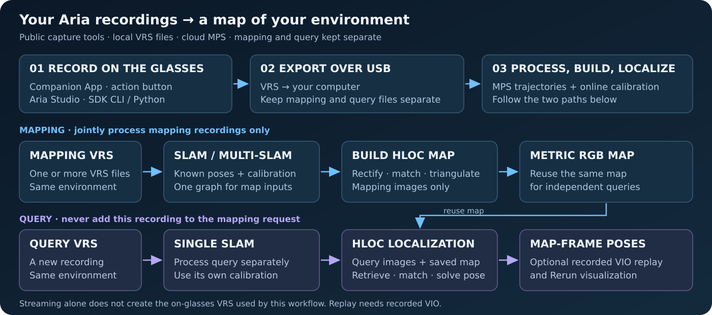

# Use your own Aria Gen 2 recordings

**Record → export VRS → process with MPS → build a map → localize a separate recording.**



Use standard Aria Gen 2 glasses supplied through the [Project Aria Research Kit][research-kit],
the public Companion App and Client SDK, and a Project Aria account with MPS access.
Follow the official setup guides for your glasses and computer. If recording or
USB export is unavailable, use [Project Aria support][support] before proceeding.

The [Pilot quickstart](../README.md#quickstart) uses already-processed public data;
no glasses or new MPS request are needed. Its notebook keeps those fixed inputs.
For your own recordings, run the commands below from this repository's root.

## Map your own space

A walked route alone does not cover every viewing direction:

- Make at least two passes, walking each route in both directions.
- Turn slowly in place at room centers and doorways to capture overlapping views.
- Cover sitting and standing head heights.
- Map in lighting similar to the conditions in which you will localize.

For multiple mapping recordings, process **only those recordings together**
with [Multi-SLAM](#3-process-with-mps). Validate using
an independent query recording and process its MPS separately. Better coverage
is not a guarantee that every accepted pose is correct.

## 1. Record on the glasses

Pair the [Companion App][companion-setup], then select a [recording profile][profiles]
with RGB, all four SLAM cameras and IMUs. `profile8` is the general-purpose
recording profile; `profile10` offers 30 Hz RGB. Include VIO for recorded replay.
Check the active profile rather than assuming a custom profile includes every sensor.

| Choose your control | Start and save |
|---|---|
| **Companion App — iOS or Android** | Dashboard → **Custom Recording** → profile → **Begin new recording**. Finish with **Complete recording**. [Guide][companion-recording] |
| **Glasses action button** | Companion App → **Glasses Settings → Action Button Customization** → assign **Start/Stop Custom Recording** and its profile. Use that configured short/long press. [Guide][action-button] |
| **Aria Studio desktop UI** | USB → **Custom Recording** → profile → **Start a Custom Recording** → **Complete Recording**. [Guide][studio-recording] |
| **Client SDK CLI / Python** | Authenticate the USB connection, then start/stop with `aria_gen2` or the [shipped Python example][python-recording]. |

All four options write the VRS **on the glasses**; copy it to your computer next.
Aria Studio 2.x is the current desktop tool, replacing the legacy Desktop App.
See the [Studio installation and platform guide][studio-setup].

**Recording is not streaming.** Companion App **Streaming** alone writes no VRS;
choose **Recording** or **Recording & Streaming**. Recording and streaming profiles
are independent. SDK [BLE control][ble-control] is not a recording or VRS-transfer path.

<details>
<summary><strong>CLI and Python recording</strong></summary>

Use **Python 3.12** with [public Client SDK 2.5.1][sdk-release], also pinned by
this example. Follow [SDK installation][sdk-setup] in a separate capture
environment and [USB device authentication][sdk-auth]; approve pairing in the
Companion App. Install `projectaria-client-sdk==2.5.1` there; do not upgrade the
pinned HLOC environment to install Studio or additional tools.

```bash
aria_gen2 auth pair
aria_gen2 auth check
aria_gen2 recording start --profile profile8 --recording-name my_room_map
# After collecting the recording:
aria_gen2 recording stop
aria_gen2 recording list
```

For untethered wearer control, use the Companion App or configured action button.
The Python example demonstrates start/stop/download and selects `profile9`;
choose a suitable recording profile for your use case. Make a separate query
recording in the same environment, not a renamed copy of the mapping VRS.

</details>

## 2. Export the VRS over USB

Choose either method, regardless of how recording started:

- **Aria Studio:** **Recordings on Glasses → Transfer to computer** → destination.
  Keep the source on the glasses and avoid replacing existing files. [Transfer guide][studio-transfer]
- **SDK CLI:** find the UUID with `aria_gen2 recording list`, then:

  ```bash
  aria_gen2 recording download -u RECORDING_UUID -o data/own
  ```

Use the actual downloaded filenames. Keep original VRS files and separate mapping
and query inputs. `mapping.vrs`, `query.vrs` and paths below are placeholders.
For an intentional all-recordings transfer, see `download-all` in the [CLI guide][sdk-recording].

## 3. Process with MPS

[Install the public MPS CLI][mps-start] in a **separate environment**, then log in
with the same Project Aria account as the Companion App. Installing the package
does not grant service access. MPS validates, encrypts and uploads the selected
VRS files, monitors processing, and downloads/extracts results.

```bash
python3 -m venv .venv-mps
source .venv-mps/bin/activate
python3 -m pip install projectaria-mps
```

Use **Python 3.12** and a fresh environment directory if `.venv-mps` exists.
Examples use interactive login; account authentication and headless options are
in the [CLI reference][mps-cli].

### One mapping recording

Request only SLAM, processing mapping and query separately:

```bash
aria_mps single -i /absolute/path/to/mapping.vrs --features SLAM
aria_mps single -i /absolute/path/to/query.vrs --features SLAM
```

Outputs are adjacent to each input: `mps_mapping_vrs/slam/` and
`mps_query_vrs/slam/`. Use the actual output paths printed by the CLI.
HLOC needs `closed_loop_trajectory.csv` and `online_calibration.jsonl`;
eye gaze, hand tracking and semi-dense points are not needed.

Wait for **completed processing and downloads**, not just upload. Rerunning the
same inputs resumes/checks an interrupted request. [Lifecycle guide][mps-lifecycle]

<details>
<summary><strong>Two or more mapping recordings: Multi-SLAM</strong></summary>

Submit only mapping recordings of the same space and device generation:

```bash
aria_mps multi \
  -i /absolute/path/to/map_a.vrs \
  -i /absolute/path/to/map_b.vrs \
  -o /absolute/path/to/mps_mapping
aria_mps single -i /absolute/path/to/query.vrs --features SLAM
```

`multi` implicitly requests Multi-SLAM and has no `--features` flag. Choose a
new output directory; service eligibility still applies. **Never add the query
to this request.** Directory inputs are searched recursively, so explicit files
avoid including it accidentally. Separate `single` requests do not align maps.

Use `vrs_to_multi_slam.json` to match each VRS to its output (such as `0/slam/`);
do not infer numbering from filenames. Mapping trajectories must share one
nonempty `graph_uid`. Disconnected components can have different IDs and cannot
be combined by this builder. [Multi-SLAM output and frame guide][multi-slam]

</details>

**Prefer a UI?** Studio requests MPS from [local recordings][studio-local] or a
[group of mapping recordings][studio-groups]. The same input/output and graph
checks apply; keep the independent query outside the mapping group.

## 4. Build and localize

Reactivate the [pinned HLOC environment](../README.md#quickstart) and apply its
worker patch. Use new map/cache/output paths:

```bash
MAP_VRS=/absolute/path/to/mapping.vrs
MAP_MPS=/absolute/path/to/mps_mapping_vrs
QUERY_VRS=/absolute/path/to/query.vrs
QUERY_MPS=/absolute/path/to/mps_query_vrs

python check_inputs.py --vrs "$MAP_VRS" --mps "$MAP_MPS"
python check_inputs.py --vrs "$QUERY_VRS" --mps "$QUERY_MPS"
python build_map.py --vrs "$MAP_VRS" --mps "$MAP_MPS" \
  --camera-set rgb --output-dir maps/my_room_rgb
python query_map.py --map maps/my_room_rgb --vrs "$QUERY_VRS" \
  --mps "$QUERY_MPS" --mode rgb --output queries/my_room_query.json
```

For multiple map inputs, check each VRS with its associated per-recording MPS
folder, then pass the Multi-SLAM root:

```bash
python build_map.py \
  --vrs /absolute/path/to/map_a.vrs /absolute/path/to/map_b.vrs \
  --mps /absolute/path/to/mps_mapping \
  --camera-set rgb --output-dir maps/my_room_multi_rgb
```

Use that multi map in the query command, with the query's separate MPS and a new
query output path. Query localization returns map-frame poses even if its MPS
`graph_uid` differs; same-graph reference error comparisons are then unavailable.
Do not jointly process the query merely to obtain comparable scores.

<details>
<summary><strong>Optional: replay recorded VIO in Rerun</strong></summary>

Only run this if the query VRS contains recorded VIO. Reuse its RGB query cache:

```bash
python replay_demo.py --map maps/my_room_rgb --vrs "$QUERY_VRS" \
  --mps "$QUERY_MPS" --fixes queries/my_room_query.json \
  --output-dir outputs/my_room_replay
rerun --bind 127.0.0.1 outputs/my_room_replay/view.rrd
```

For a multi map, use `maps/my_room_multi_rgb`, its query cache and new output
paths. For live operation, map the actual environment first, then follow the
[live VIO guide](../README.md#runtime-and-frame-contracts). The Pilot apartment
map is not a map of your room; its reported scores are not results for your data.

</details>

[research-kit]: https://www.projectaria.com/research-kit/
[support]: https://facebookresearch.github.io/projectaria_tools/gen2/ark/support
[companion-setup]: https://facebookresearch.github.io/projectaria_tools/gen2/ark/companion-app/start
[companion-recording]: https://facebookresearch.github.io/projectaria_tools/gen2/ark/companion-app/recording
[action-button]: https://facebookresearch.github.io/projectaria_tools/gen2/ark/companion-app/action-button
[profiles]: https://facebookresearch.github.io/projectaria_tools/gen2/technical-specs/device/profile
[studio-setup]: https://facebookresearch.github.io/projectaria_tools/gen2/ark/aria_studio/start
[studio-recording]: https://facebookresearch.github.io/projectaria_tools/gen2/ark/aria_studio/new-recording
[studio-transfer]: https://facebookresearch.github.io/projectaria_tools/gen2/ark/aria_studio/glasses
[studio-local]: https://facebookresearch.github.io/projectaria_tools/gen2/ark/aria_studio/recordings
[studio-groups]: https://facebookresearch.github.io/projectaria_tools/gen2/ark/aria_studio/groups
[sdk-setup]: https://facebookresearch.github.io/projectaria_tools/gen2/ark/client-sdk/start
[sdk-auth]: https://facebookresearch.github.io/projectaria_tools/gen2/ark/client-sdk/authentication
[sdk-recording]: https://facebookresearch.github.io/projectaria_tools/gen2/ark/client-sdk/recording
[sdk-release]: https://pypi.org/project/projectaria-client-sdk/2.5.1/
[python-recording]: https://facebookresearch.github.io/projectaria_tools/gen2/ark/client-sdk/python-sdk/recording-example
[ble-control]: https://facebookresearch.github.io/projectaria_tools/gen2/ark/client-sdk/ble-control
[mps-start]: https://facebookresearch.github.io/projectaria_tools/gen2/ark/mps/start
[mps-cli]: https://facebookresearch.github.io/projectaria_tools/gen2/technical-specs/mps/mps_cli_guide
[multi-slam]: https://facebookresearch.github.io/projectaria_tools/gen2/technical-specs/mps/data_formats/slam/mps_multi_slam
[mps-lifecycle]: https://facebookresearch.github.io/projectaria_tools/gen2/ark/mps/mps_data_lifecycle
